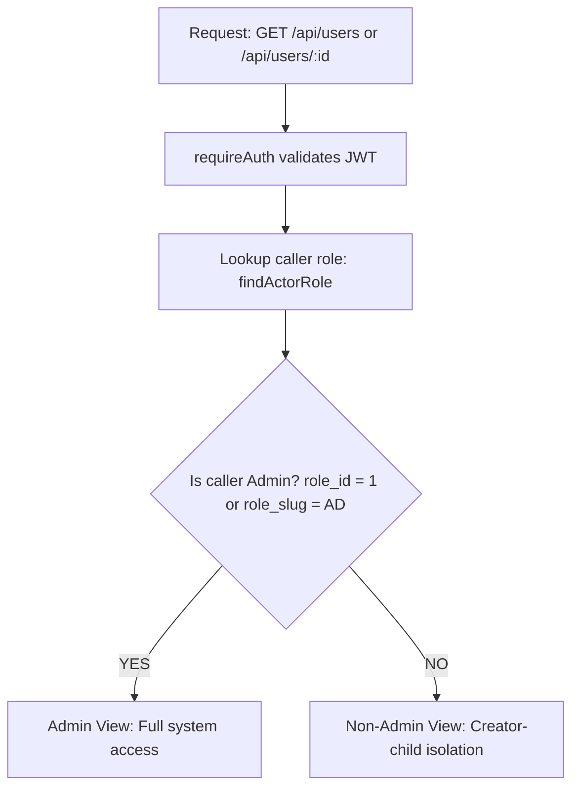

# Get User Module — User Retrieval API

This module provides user retrieval endpoints for the AQUAPAY fintech platform. It supports full-access retrieval for **Admin** users and strict creator-child data isolation for **non-admin** users.

---

## 1. Endpoints

| Method | Endpoint | Authorization | Description |
| :--- | :--- | :--- | :--- |
| `GET` | `/api/users` | Bearer Token (`requireAuth`) | List all users for Admin or list child users for non-admin users. Supports the `kyc_status` filter. |
| `GET` | `/api/users/:id` | Bearer Token (`requireAuth`) | Get a user by ID, including the simplified KYC status and progress information. |

---

## 2. Access Control & Authorization Rules

The endpoint retrieves the authenticated user's role and applies the following authorization logic:



### Admin Access (`role_id: 1` / `role_slug: 'AD'`)

- **`GET /api/users`**: Returns all registered users across the system. Supports filtering by KYC status using `?kyc_status=`. Supported statuses are `pending`, `submitted`, `under_review`, `approved`, and `rejected`.
- **`GET /api/users/:id`**: Returns the user with the matching ID, or `404 Not Found` if the user does not exist.

### Non-Admin Access (Sub Admin, MD, Distributor, Retailer, etc.)

- **`GET /api/users`**: Returns only child users directly created by the authenticated caller (`WHERE parent_id = caller.id`).
- **`GET /api/users/:id`**: Returns a user only if that user was created by the authenticated caller (`WHERE id = ? AND parent_id = caller.id`).
- **Retailers (`RT`)**: If a retailer has no child users, `GET /api/users` returns an empty array (`[]`).

### KYC Permissions Policy

- **Visibility**: Admins and parent managers can view the simplified KYC information for users they are authorized to access.
- **Execution and approval**: KYC verification, review, and approval must be handled through the appropriate authorized KYC workflow. The user retrieval endpoints do not approve or reject KYC applications.

---

## 3. Headers & Authentication

All requests require a valid JWT access token passed through the `Authorization` header.

```http
Authorization: Bearer <valid_jwt_token>
```

- The token must be signed with the configured `JWT_SECRET`.
- The caller's account must be active in the database.
- Missing or invalid tokens return `401 Unauthorized`.

---

## 4. Response Schemas

### Success Response — `GET /api/users`

**Status:** `200 OK`

```json
{
  "statusCode": 200,
  "data": [
    {
      "id": 12,
      "name": "Suresh Sharma",
      "email": "suresh@example.com",
      "mobile": "+919876543210",
      "shopname": "Sharma Telecom",
      "address": "Shop 4, MG Road",
      "state": "Maharashtra",
      "city": "Mumbai",
      "pincode": "400001",
      "status": "active",
      "role_id": 7,
      "role_name": "Distributor",
      "role_slug": "DT",
      "company_id": 1,
      "company_name": "AquaPay Financial",
      "parent_id": 5,
      "parent_name": "Rajesh Kumar",
      "kyc": {
        "status": "pending",
        "steps_completed": 0,
        "business_type": "Private Limited Company"
      },
      "created_at": "2026-10-21T10:00:00.000Z",
      "updated_at": "2026-10-21T10:30:00.000Z"
    }
  ],
  "message": "Users fetched successfully",
  "success": true
}
```

### Success Response — `GET /api/users/:id`

**Status:** `200 OK`

```json
{
  "statusCode": 200,
  "data": {
    "id": 12,
    "name": "Suresh Sharma",
    "email": "suresh@example.com",
    "mobile": "+919876543210",
    "shopname": "Sharma Telecom",
    "address": "Shop 4, MG Road",
    "state": "Maharashtra",
    "city": "Mumbai",
    "pincode": "400001",
    "status": "active",
    "role_id": 7,
    "role_name": "Distributor",
    "role_slug": "DT",
    "company_id": 1,
    "company_name": "AquaPay Financial",
    "parent_id": 5,
    "parent_name": "Rajesh Kumar",
    "kyc": {
      "status": "pending",
      "steps_completed": 0,
      "business_type": "Private Limited Company"
    },
    "created_at": "2026-10-21T10:00:00.000Z",
    "updated_at": "2026-10-21T10:30:00.000Z"
  },
  "message": "User details fetched successfully",
  "success": true
}
```

### KYC Status Definitions

| Status | Meaning |
| :--- | :--- |
| `pending` | KYC has not yet been submitted for review. |
| `submitted` | All required KYC steps have been completed and the application has been submitted for review. |
| `under_review` | An authorized reviewer is reviewing the submitted application. |
| `approved` | KYC has been approved by an authorized reviewer. |
| `rejected` | KYC has been rejected by an authorized reviewer. |

### KYC Progress

- `steps_completed` is a number from `0` to `7`.
- A value of `0` means no KYC steps have been completed.
- A value of `7` means all seven steps have been completed. It does not, by itself, mean the KYC application has been approved.
- The KYC status should become `submitted` only after all required steps succeed and the application is successfully submitted.
- KYC must not be marked `approved` automatically when the steps are completed.
- `business_type` identifies the business type selected during onboarding.

### KYC Filter Example

```http
GET /api/users?kyc_status=pending
Authorization: Bearer <valid_jwt_token>
```

Other supported values for `kyc_status` are:

- `submitted`
- `under_review`
- `approved`
- `rejected`

The filter applies to the users visible to the authenticated caller. Non-admin users remain restricted to their own child users.

---

## 5. Security & Data Protection

1. **Sensitive fields excluded:** Password hashes, password-recovery tokens, and internal database-only fields must not be exposed in user retrieval responses.
2. **Explicit SQL columns:** Database queries use explicit column names and table aliases to avoid ambiguous-column errors, particularly when joining the `users` table to itself.
3. **User ID validation:** User IDs must be positive safe integers. Invalid IDs, including decimals, non-numeric values, and non-positive numbers, return `400 Bad Request`.
4. **Authorization enforcement:** Non-admin callers can access only users directly created by them. Knowing another user's ID does not grant access.
5. **Minimal KYC response:** User retrieval responses expose only `status`, `steps_completed`, and `business_type` under `kyc`. Internal case identifiers, step-level records, timestamps, failure codes, and rejection details are not part of this response.
6. **KYC approval protection:** Reading user information does not change KYC state or grant permission to approve or reject an application.

---

## 6. Important Implementation Notes

- The examples above illustrate the documented response structure; actual values depend on the database records.
- A user without an initialized KYC case may have `kyc: null`, depending on the current database state and model implementation.
- KYC status filters must be validated against the supported status values before being used in database queries.
- Business type options should be validated by the backend against the business types approved for the application. Frontend dropdown validation alone is not sufficient.
- Keep this README synchronized with the actual route, controller, service, model, and database implementations.
