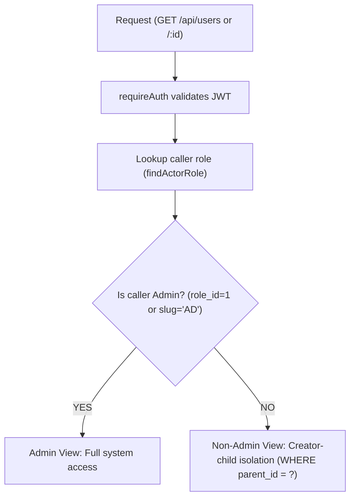

# Get User Module — User Retrieval API

This module provides user retrieval endpoints for the AQUAPAY fintech platform. It supports full-access retrieval for **Admin** users and strict creator-child data isolation for **non-admin** users.

---

## 1. Endpoints

| Method | Endpoint | Authorization | Description |
| :--- | :--- | :--- | :--- |
| `GET` | `/api/users` | Bearer Token (`requireAuth`) | List all users (Admin) or list child users (Non-Admin). Supports `?kyc_status=` filter. |
| `GET` | `/api/users/:id` | Bearer Token (`requireAuth`) | Get user by ID with full KYC case and step-by-step progress |

---

## 2. Access Control & Authorization Rules

The endpoint retrieves the authenticated user's role and applies the following authorization logic:



### Admin Access (`role_id: 1` / `role_slug: 'AD'`)
* **`GET /api/users`**: Returns **all** registered users across the system. Supports `?kyc_status=submitted` (or `draft`, `under_review`, `approved`, `rejected`) for Admin KYC review queues.
* **`GET /api/users/:id`**: Returns any user with matching ID including full KYC case details and step progress, or `404 Not Found` if the user ID does not exist.

### Non-Admin Access (Sub Admin, MD, Distributor, Retailer, etc.)
* **`GET /api/users`**: Returns **only** child users directly created by the caller (`WHERE parent_id = caller.id`).
* **`GET /api/users/:id`**: Returns the user **only** if they were created by the caller (`WHERE id = ? AND parent_id = caller.id`).
* **Retailers (`RT`)**: As retailers cannot create child users, `GET /api/users` returns an empty array `[]`.

### KYC Permissions Policy
* **Visibility**: Both Admin and parent managers can view `kyc` status, case metadata, and step progression for accessible users in GET responses to monitor downline onboarding.
* **Execution & Approval**: KYC review, verification, and status approval are performed exclusively by administrators. Parent managers possess read-only visibility.

---

## 3. Headers & Authentication

All requests require a valid JWT access token passed via the `Authorization` header:

```http
Authorization: Bearer <valid_jwt_token>
```

* Token must be signed with the configured `JWT_SECRET`.
* Caller account must be `active` in the database.
* Missing or invalid tokens return `401 Unauthorized`.

---

## 4. Response Schemas

### Success Response (`GET /api/users`)
**Status:** `200 OK`

```json
{
  "statusCode": 200,
  "data": [
    {
      "id": 12,
      "name": "Suresh Sharma",
      "email": "suresh@example.com",
      "mobile": "+919876543210",
      "shopname": "Sharma Telecom",
      "address": "Shop 4, MG Road",
      "state": "Maharashtra",
      "city": "Mumbai",
      "pincode": "400001",
      "status": "active",
      "role_id": 7,
      "role_name": "Distributor",
      "role_slug": "DT",
      "company_id": 1,
      "company_name": "AquaPay Financial",
      "parent_id": 5,
      "parent_name": "Rajesh Kumar",
      "kyc": {
        "case_id": 3,
        "status": "draft",
        "current_step": 1,
        "business_type": "Telecom Store",
        "submitted_at": null,
        "reviewed_at": null,
        "rejection_reason": null
      },
      "created_at": "2026-10-21T10:00:00.000Z",
      "updated_at": "2026-10-21T10:30:00.000Z"
    }
  ],
  "message": "Users fetched successfully",
  "success": true
}
```

### Success Response (`GET /api/users/:id`)
**Status:** `200 OK`

```json
{
  "statusCode": 200,
  "data": {
    "id": 12,
    "name": "Suresh Sharma",
    "email": "suresh@example.com",
    "mobile": "+919876543210",
    "shopname": "Sharma Telecom",
    "address": "Shop 4, MG Road",
    "state": "Maharashtra",
    "city": "Mumbai",
    "pincode": "400001",
    "status": "active",
    "role_id": 7,
    "role_name": "Distributor",
    "role_slug": "DT",
    "company_id": 1,
    "company_name": "AquaPay Financial",
    "parent_id": 5,
    "parent_name": "Rajesh Kumar",
    "kyc": {
      "case_id": 3,
      "status": "in_progress",
      "current_step": 2,
      "business_type": "Telecom Store",
      "submitted_at": null,
      "reviewed_at": null,
      "rejection_reason": null,
      "steps": [
        { "step_number": 1, "status": "completed", "completed_at": "2026-10-21T10:15:00.000Z", "failure_code": null },
        { "step_number": 2, "status": "in_progress", "completed_at": null, "failure_code": null },
        { "step_number": 3, "status": "pending", "completed_at": null, "failure_code": null }
      ]
    },
    "created_at": "2026-10-21T10:00:00.000Z",
    "updated_at": "2026-10-21T10:30:00.000Z"
  },
  "message": "User details fetched successfully",
  "success": true
}
```

---

## 5. Security & Data Protection

1. **Excluded Sensitive Fields:** Passwords (`password_hash`), internal database singleton flags (`admin_singleton`), and recovery tokens are strictly omitted from all queries.
2. **Ambiguity Prevention:** All database queries utilize explicit table prefixes (`u.address`, `u.pincode`, `u.shopname`, etc.) to prevent MySQL `ER_NON_UNIQ_ERROR` errors during self-joins.
3. **ID Parameter Validation:** User IDs are validated as positive safe integers (`Number.isSafeInteger(id)` and `id > 0`), rejecting decimals, non-numeric values, or malicious inputs with `400 Bad Request`.
